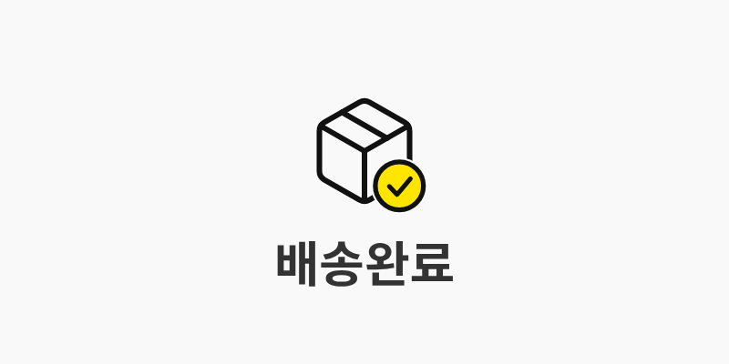
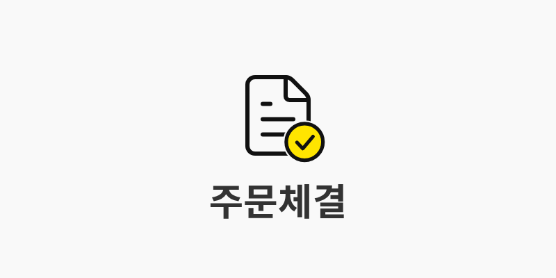
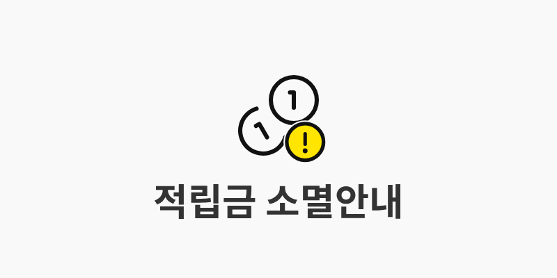
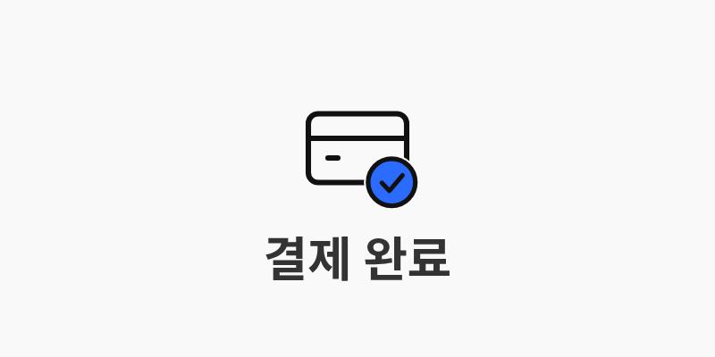
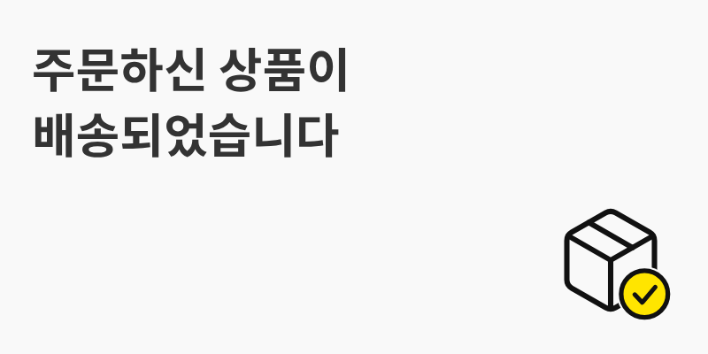
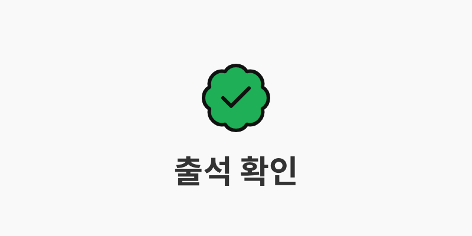
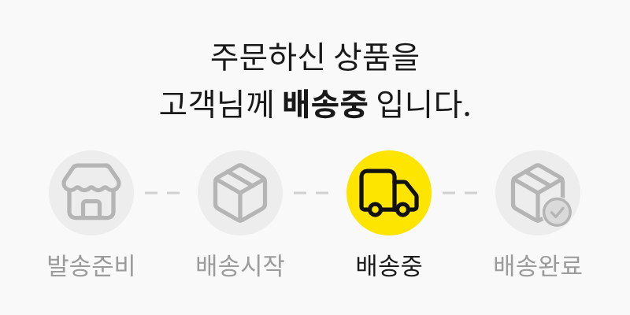

# alimtalk-kit

> 카카오 알림톡을 **규격에 맞게, 예쁘게, 바로** 만들어 주는 에이전트 스킬

  

"배송 완료 알림톡 이미지형으로 만들어줘" 한마디면 에이전트가 템플릿 문구와 800×400 이미지를 카카오 제작가이드 좌표 그대로 만들고, 규격을 검증한 뒤, 승인을 받아 [SOLAPI](https://solapi.com) `solactl`로 등록·검수 요청·발송까지 안내합니다.

[Agent Skills](https://agentskills.io) 형식(`SKILL.md`)이라 Claude Code, Codex, Cursor 등 이 형식을 읽는 에이전트에서 쓸 수 있습니다.

## 미리보기

이 키트가 만든 이미지입니다(전부 800×400, 배경 `#F9F9F9`, Spoqa Han Sans Bold 54px).

| 아이콘형 (체크 뱃지) | 아이콘형 (문서 + 체크) |
|---|---|
|  |  |
| **아이콘형 (느낌표 뱃지)** | **아이콘형 (브랜드 색)** |
|  |  |
| **텍스트 혼합형 + 아이콘** | **텍스트 혼합형 + AI 일러스트** |
|  |  |
| **텍스트 혼합형 + 캐릭터 (아카데밍)** | **아이콘형 (아카데밍 브랜드 색)** |
|  |  |
| **로고형** | **배송 단계형** |
|  |  |

> - 로고(ACME MART)는 가상의 로고이고, 택배 밴 일러스트는 `imagegen`으로 만든 뒤 배경을 자동 제거해 합성한 것입니다.
> - 아카데밍 예시의 캐릭터 이미지는 아카데밍의 것으로, 예시 목적으로만 사용했습니다. 이 레포의 Apache-2.0 라이선스 대상이 아닙니다.
> - 브랜드 캐릭터·일러스트는 `--art`로 넣으면 단색 배경이 자동으로 `#F9F9F9`에 맞춰집니다. 포인트 색은 `--accent`로 브랜드 색을 지정합니다(아카데밍 초록 `#1EAF57`).

## 이럴 때 쓰세요

- "배송 완료 / 주문 체결 / 예약 확정 알림톡 이미지 만들어줘"
- "알림톡 템플릿 문구 써줘, 변수는 고객명·주문번호"
- "우리 로고로 알림톡 로고형 이미지 만들어줘"
- "이 일러스트로 알림톡 이미지 만들어줘 (배경색 알아서 맞춰줘)"
- "이 템플릿 글자수·변수 규칙 맞는지 검증해줘"
- "알림톡 템플릿 등록하고 검수 요청해줘 / 테스트 발송해줘"
- "알림톡이 이미지 때문에 반려됐어, 뭐가 문제야?"

## 무엇을 해주나

| | |
|---|---|
| **이미지 4종** | 아이콘형 · 텍스트 혼합형 · 로고형 · 배송 단계형을 공식 좌표대로 렌더링 (여백 42/36/76, 텍스트 영역 520×240, 아이콘 180×180 …) |
| **규격 고정** | 배경 `#F9F9F9`, 텍스트 `#333333` Bold, **Spoqa Han Sans 54px**, 자간 0 — 바꾸면 반려되는 값은 코드에서 고정 |
| **일러스트 보정** | `imagegen` 등으로 만든 소재의 배경을 자동 제거하고 `#F9F9F9` 위에 합성, 500KB 이하로 압축 |
| **아이콘 73종** | 카카오 가이드의 아이콘 이름(배송완료, 쿠폰, 일정 …)에 맞춘 번들 아이콘. 선 굵기·색은 공식 아이콘에서 샘플링, 우하단 체크/느낌표 뱃지, 브랜드 포인트 색 지정 |
| **사전 검증** | 이미지(크기·비율·용량·배경색·투명), 템플릿(글자수·변수·버튼·유형 조합·광고성 표현) |
| **등록·발송 안내** | 이미지 업로드 → 템플릿 등록 → 검수 요청 → 테스트 발송, **모든 외부 변경은 사용자 승인 후** |

## 설치

### 1. 스킬 설치

```bash
# 레포 전체 (대화형으로 에이전트 선택)
npx skills add JunDev76/alimtalk-kit

# 이 스킬만, 특정 에이전트에
npx skills add JunDev76/alimtalk-kit@alimtalk-kit -a claude-code

# 전역 설치 (모든 프로젝트에서 사용)
npx skills add JunDev76/alimtalk-kit -g
```

`npx skills`에는 Node.js 22.20+가 필요합니다. 설치되는 폴더 이름은 `alimtalk-kit`입니다.

수동 설치도 됩니다. `skills/alimtalk-kit` 폴더를 에이전트의 스킬 폴더에 통째로 복사하세요.

| 에이전트 | 위치 |
|---|---|
| Claude Code | `~/.claude/skills/alimtalk-kit/` (전역) 또는 `<프로젝트>/.claude/skills/alimtalk-kit/` |
| 그 밖의 에이전트 | 해당 에이전트의 skills 폴더 (예: `.agents/skills/`) |

### 2. 스크립트 의존성 설치 (최초 1회)

```bash
cd <설치된 경로>/alimtalk-kit/scripts
pnpm install        # 또는 npm install
node render.mjs --help
```

Node.js 22 이상이 필요합니다. `@napi-rs/canvas`, `sharp`, `ag-psd`는 미리 빌드된 바이너리를 쓰므로 컴파일러는 필요 없습니다.

### 3. solactl 설치 (등록·발송할 때만)

이미지 제작·검증만 한다면 필요 없습니다. 템플릿 등록과 발송에는 [`solactl`](https://github.com/solapi/solactl)과 SOLAPI API Key/Secret, 연동된 카카오 채널, 등록된 발신번호가 필요합니다.

```bash
curl -fsSL https://raw.githubusercontent.com/solapi/solactl/main/scripts/install.sh | bash
solactl configure --profile mine     # 대화형. Secret은 명령행 인자로 넘기지 마세요
```

## 사용법

### 에이전트에게 말하기 (권장)

스킬이 설치되어 있으면 알림톡 관련 요청에서 자동으로 불러옵니다. 구체적일수록 좋습니다.

```text
배송 완료 알림톡 이미지형으로 만들어줘. 브랜드 색은 #2B6CFF.
본문에는 고객명, 주문번호, 배송지 변수가 들어가야 해.
```

```text
이 로고(./logo.png)로 알림톡 로고형 이미지 만들어줘.
```

```text
imagegen으로 택배 트럭 일러스트 만들어서 "오늘 배송이 시작되었습니다" 텍스트 혼합형으로 만들어줘.
```

```text
방금 만든 템플릿으로 solactl 등록하고 검수 요청해줘. 프로필은 mine.
```

에이전트는 보통 이렇게 진행합니다.

```
요구 파악 ─▶ 유형 선택 ─▶ 템플릿 JSON 작성 ─▶ validate-template
   ─▶ 이미지 렌더링 ─▶ 결과 PNG 눈으로 확인 + validate-image
   ─▶ 최종본 제시(본문·변수·버튼·이미지·명령)
   ─▶ [사용자 승인] ─▶ 이미지 업로드 ─▶ 템플릿 등록 ─▶ 검수 요청
   ─▶ [승인된 뒤, 사용자 승인] ─▶ 테스트 발송 ─▶ 본 발송
```

### 스크립트 직접 실행

`scripts/` 폴더에서 실행합니다. 모든 명령은 JSON 결과를 출력하고, 규격 오류가 있으면 종료 코드 1을 반환합니다.

#### 아이콘형 — 상태 한 가지를 크게

```bash
node render.mjs --type icon --icon 배송완료 --text "배송완료" --out out.png
node render.mjs --type icon --icon 주문완료 --text "주문체결" --out out.png
node render.mjs --type icon --icon 결제 --text "결제 완료" --accent "#2B6CFF" --style outline --badge check --out out.png
```

텍스트는 **1줄, 2~9자(띄어쓰기 포함)**, 4자 이상 권장.

#### 텍스트 혼합형 — 문구 + 우하단 아이콘/일러스트

```bash
# 아이콘
node render.mjs --type text --text "주문하신 상품이|배송되었습니다" --icon 배송완료 --out out.png

# 일러스트 (imagegen 등으로 만든 이미지, 배경 자동 제거)
node render.mjs --type text --text "오늘 배송이|시작되었습니다" --art ./van.png --out out.png
```

줄바꿈은 `|`로 직접 지정합니다. 최소 4자, **2줄/20자 권장**(최대 3줄/30자).

#### 로고형 — 가로형 로고

```bash
node render.mjs --type logo --logo ./logo.png --out out.png
node render.mjs --type logo --logo ./logo.png --tall --out out.png   # 영역을 벗어나는 형태: 위·아래 25px 확장
```

#### 배송 단계형 — 4단계 중 현재 단계 강조

```bash
node render.mjs --type steps --lines "주문하신 상품을|고객님께 **배송중** 입니다." --active 2 --out out.png
```

`**굵게**`로 핵심 단어를 강조합니다. `--steps "발송준비,배송시작,배송중,배송완료"`, `--icons "배송준비,배송시작,배송중,배송완료"`로 단계명과 아이콘을 바꿀 수 있습니다. 공식 PDF에서 측정한 **근사 좌표**라 경고가 나옵니다.

#### 옵션 요약

| 옵션 | 설명 |
|---|---|
| `--type icon\|text\|logo\|steps` | 이미지 유형 |
| `--text "..."` | 문구. `\|` 또는 `\n`으로 줄 구분 |
| `--icon NAME` | 번들 아이콘(한글 이름 또는 Lucide id), 파일 경로, `official:이름` |
| `--art FILE` | 일러스트/오브젝트(텍스트 혼합형). 배경 자동 제거 |
| `--bleed` | 큰 일러스트를 우하단 모서리에 붙여 최대 400×320으로 |
| `--art-scale 0.5~1` | 일러스트 크기 배율("좀 작게"). 긴 변이 230px 아래로는 줄지 않음 |
| `--icon-scale 0.75~1.1` | 아이콘 글리프 크기 배율 |
| `--logo FILE` | 로고 이미지(로고형) |
| `--accent COLOR` | 아이콘 포인트 색(기본 공식 노랑 `#FFE500`). `none`이면 외곽선만 |
| `--style fill\|outline` | 아이콘 스타일. `outline`은 외곽선 + 뱃지(공식 배송완료·주문체결 스타일) |
| `--badge check\|alert\|none` | 우하단 노란 원 뱃지 |
| `--out FILE` | 출력 경로. 500KB를 넘으면 자동 압축 |
| `--list-icons` | 사용 가능한 아이콘 이름 |

### imagegen 연동

에이전트에 `imagegen` 같은 이미지 생성 도구가 있으면 우하단 일러스트를 즉석에서 만들 수 있습니다. 배경 보정은 `render.mjs --art`가 합니다.

1. 단색 배경에 고립된 소재로 생성합니다. 스킬이 에이전트에게 이런 프롬프트를 쓰도록 안내합니다.
   `flat vector illustration of a delivery van, bold dark outlines, limited palette, centered, isolated on a plain pure white background, no text, no shadow`
2. 가장자리에서 이어진 배경만 제거하므로 그림 안쪽의 흰색(눈동자, 창문 등)은 남습니다.
3. `#F9F9F9` 캔버스에 합성되어 배경색 규정을 지킵니다.
4. 가장자리와 잘림은 **결과 PNG를 열어 직접 확인**하세요(자동 제거 경고가 출력됩니다).

소재 안에 글자를 넣지 마세요. 우하단 오브젝트 안의 글자는 반려 사유입니다.

### 템플릿 검증

```bash
node validate-template.mjs template.json
```

```json
{
  "name": "배송 완료 안내",
  "messageType": "BA",
  "emphasizeType": "IMAGE",
  "imageId": "ST01FZ_...",
  "content": "#{고객명}님, 주문하신 상품이 배송 완료되었습니다.\n\n■ 주문번호: #{주문번호}\n■ 배송지: #{배송지}",
  "buttons": [
    { "buttonType": "WL", "buttonName": "주문 상세 보기", "linkMo": "https://example.com/orders" }
  ]
}
```

본문 1,000자, 부가정보 500자·변수 불가, 강조표기 제목 50자·보조문구 18자, 버튼 5개·버튼명 14자, 아이템리스트 조건, 유형 간 충돌, 포괄적 변수(`#{내용}`), 광고성 표현 등을 검사합니다. 필드 이름은 `solactl kakao template create` 옵션과 대응합니다.

### 이미지 검증

```bash
node validate-image.mjs out.png
```

형식(PNG/JPG), 500KB, 2:1 비율과 최소 크기, 투명 픽셀, 네 모서리 `#F9F9F9`, 배경색 비율을 확인합니다. 직접 만든 이미지도 검사할 수 있습니다.

### 등록·발송 (solactl)

```bash
# 1) 이미지 업로드 → imageId (solactl에 업로드 명령이 없어 스크립트가 SOLAPI REST를 호출)
node upload-image.mjs out.png --profile mine --dry-run     # 먼저 요약만
node upload-image.mjs out.png --profile mine

# 2) 템플릿 등록 → 3) 검수 요청
solactl --profile mine kakao template create --channel-id <id> --name "배송 완료 안내" \
  --category-code <코드> --message-type BA --emphasize-type IMAGE --image-id <imageId> \
  --content "$(cat content.txt)" --buttons "$(cat buttons.json)"
solactl --profile mine kakao template inspect <templateId> --comment "주문 고객 대상 정보성 안내"

# 4) 승인된 뒤 발송 (먼저 본인 번호로 테스트)
solactl --profile mine send ata --to 01012345678 --from 0212345678 \
  --pfid <pfid> --template-id <templateId> --variables '{"#{고객명}":"홍길동","#{주문번호}":"A-1001"}'
```

전체 순서와 주의점은 [`references/solactl-workflow.md`](skills/alimtalk-kit/references/solactl-workflow.md)를 보세요.

> **안전 원칙** 이미지 업로드, 템플릿 생성·수정·삭제, 검수 요청, 발송은 외부 상태를 바꿉니다. 스킬은 프로필·채널·수신자·본문·변수·이미지 미리보기·실행 명령을 먼저 보여주고 **사용자 승인 뒤에만** 실행하도록 에이전트에게 지시합니다. 소수 테스트 발송 후 본 발송, 실패 후 무작정 재실행 금지, Secret 출력 금지도 포함됩니다.

## 이미지 규격 한눈에

| 항목 | 값 |
|---|---|
| 캔버스 | 800×400 (2:1), PNG/JPG, 500KB 이하 |
| 배경 | `#F9F9F9`만 (흰색·브랜드색 불가) |
| 텍스트 | Spoqa Han Sans **Bold 54px**, `#333333`, 자간 0 |
| 아이콘형 | 아이콘 180×180 `x310 y76`, 텍스트 460×68 `x170 y256` 가운데 정렬, 1줄 2~9자 |
| 텍스트 혼합형 | 텍스트 520×240 `x36 y42` 좌측 정렬, 행간 74, 아이콘 180×180(우 20·하 16), 일러스트 230×230 ~ 400×320 |
| 로고형 | 영역 600×150 `x100 y125`, 가로형 로고 가운데 |

정확한 좌표와 근거, 불확실한 항목은 [`references/image-spec.md`](skills/alimtalk-kit/references/image-spec.md)에 있습니다.

## 아이콘

- **번들 아이콘 73종**: 카카오 가이드의 아이콘 이름에 맞춘 [Lucide](https://lucide.dev)(ISC) 기반입니다. 카카오 공식 아이콘이 **아니며**, 선 굵기(약 6px)와 색(`#111111`/`#FFE500`)만 공식 아이콘에서 맞췄습니다. 목록은 [`references/icons.md`](skills/alimtalk-kit/references/icons.md) 또는 `node render.mjs --list-icons`.
- **카카오 공식 아이콘**: 카카오가 권리를 가지며 알림톡 외 사용·2차 가공·재배포가 금지돼 있어 이 레포에 **포함하지 않습니다**. 필요하면 본인 PC에서 공식 가이드의 파일을 받아 씁니다.

```bash
node fetch-official-assets.mjs    # 공식 가이드 페이지에서 PSD/Sketch를 ~/.cache/alimtalk-kit 에 저장
node import-icons.mjs             # PSD의 icon_* 레이어 추출 (4종: 배송2, 주문체결, 적립금, 음식점)
node render.mjs --type icon --icon official:배송2 --text "배송완료" --out out.png
```

- 직접 만든 아이콘은 `--icon ./my-icon.svg|png`로 바로 쓸 수 있습니다.

## 구성

```
alimtalk-kit/
├── README.md
├── LICENSE                        Apache-2.0
├── NOTICE                         저작권·서드파티 고지
├── docs/examples/                 README 예시 이미지
└── skills/alimtalk-kit/
    ├── SKILL.md                   에이전트가 읽는 워크플로·규칙
    ├── references/                필요할 때만 읽는 상세 문서
    │   ├── image-spec.md            이미지 좌표 규격과 근거
    │   ├── template-spec.md         템플릿 유형·제한·JSON 스키마
    │   ├── solactl-workflow.md      업로드·등록·검수·발송 순서
    │   ├── review-rules.md          반려 사유, 정보성/광고성
    │   └── icons.md                 아이콘 목록, 공식 아이콘
    ├── scripts/                   render / validate-* / upload-image / fetch-official-assets / import-icons
    └── assets/
        ├── fonts/                 Spoqa Han Sans Regular·Bold (SIL OFL 1.1)
        └── icons/                 번들 아이콘 (ISC)
```

## 문제 해결

| 증상 | 확인 |
|---|---|
| `폰트 파일이 없습니다` / `폰트 등록 실패` | `assets/fonts/`의 TTF 두 개가 있는지. 폰트가 없으면 시스템 폰트로 대체하지 않고 중단합니다 |
| `Cannot find module '@napi-rs/canvas'` | `scripts/`에서 `pnpm install`(또는 `npm install`)을 실행했는지 |
| 일러스트 가장자리에 흰 테두리/잘림 | 배경이 단색인 소재로 다시 생성. 배경이 복잡하면 자동 제거가 불완전합니다 |
| `모서리 색이 배경 #F9F9F9가 아닙니다` | 직접 만든 이미지의 배경을 `#F9F9F9`로 칠하거나 `render.mjs --art/--logo`로 합성 |
| 텍스트가 영역을 넘는다는 경고 | `\|`로 줄을 더 나누거나 글자 수를 줄이세요 (한 줄 약 10자) |
| `공식 아이콘 ... 이 없습니다` | `fetch-official-assets.mjs` → `import-icons.mjs`를 먼저 실행 |
| 공식 파일 다운로드 실패 | 공식 페이지 HTML의 토큰 링크가 바뀐 경우입니다. 안내된 페이지에서 직접 받아 캐시 폴더에 `alimtalk-image-template.psd`로 저장 |
| 검수 반려 | `solactl kakao template get <id>`로 사유 확인 후 [`references/review-rules.md`](skills/alimtalk-kit/references/review-rules.md) |

캐시 위치는 환경 변수 `ALIMTALK_KIT_CACHE`로 바꿀 수 있습니다(기본 `~/.cache/alimtalk-kit`).

## 한계와 면책

- **카카오 검수 통과를 보장하지 않습니다.** 검증은 사전 점검이며 최종 기준은 [카카오 공식 가이드](https://kakaobusiness.gitbook.io/sandbox2025/ad/bizmessage/notice-friend/content-guide/image)입니다.
- 배송 단계형은 공식 PDF 템플릿에서 측정한 **근사 좌표**입니다. 로고형 "25px 추가"와 혼합형 텍스트 폭(520 vs 540)은 공식 자료 간 차이가 있어 가이드 도판 값을 따랐습니다. 자세한 내용은 `references/image-spec.md`의 "불확실한 항목".
- 생성형 AI 소재는 카카오 심사에서 별도 표기·제한이 있을 수 있습니다. 공식 심사 가이드를 확인하세요. 실존 인물·유명 캐릭터·타사 상표는 만들지 마세요.
- 광고성 발송, 수신 동의, 야간 발송 등 법적 요건은 이 키트가 보장하지 않습니다. 알림톡은 정보성 메시지여야 합니다.
- 카카오, SOLAPI와 제휴 관계가 없는 **비공식** 도구입니다.

## 기여

이슈와 PR을 환영합니다. 규격이 바뀌었거나 좌표가 어긋난 경우 공식 가이드 링크와 함께 알려주세요. 값을 바꿀 때는 `scripts/lib/spec.mjs`와 `references/image-spec.md`를 함께 고칩니다.

## 라이선스

코드는 [Apache License 2.0](LICENSE)입니다. 재배포·파생물에는 [NOTICE](NOTICE)의 저작권 표시를 유지해야 합니다. `docs/examples/`의 아카데밍 캐릭터 이미지는 Apache-2.0 대상이 아닙니다. 번들 폰트는 SIL OFL 1.1(`assets/fonts/LICENSE_OFL.txt`), 번들 아이콘은 ISC(`assets/icons/LICENSE-lucide.txt`)입니다. 카카오 공식 에셋(아이콘·PSD·Sketch)은 포함하지 않습니다.

## 참고

- [Agent Skills 규격](https://agentskills.io) · [skills CLI](https://github.com/vercel-labs/skills)
- [카카오비즈니스 알림톡 이미지형 제작가이드](https://kakaobusiness.gitbook.io/sandbox2025/ad/bizmessage/notice-friend/content-guide/image)
- [SOLAPI 개발자 문서](https://solapi.com/developers/api/start) · [solactl](https://github.com/solapi/solactl)
- [Spoqa Han Sans](https://github.com/spoqa/spoqa-han-sans) · [Lucide](https://lucide.dev)
